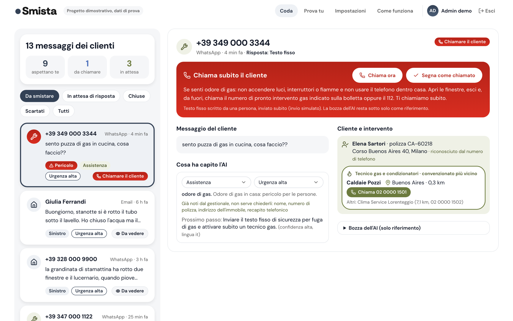
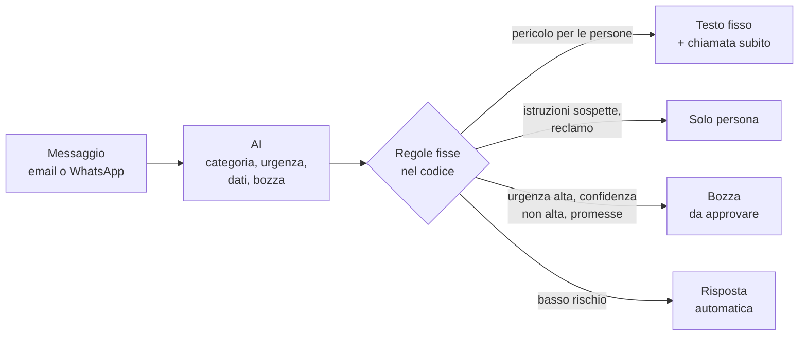
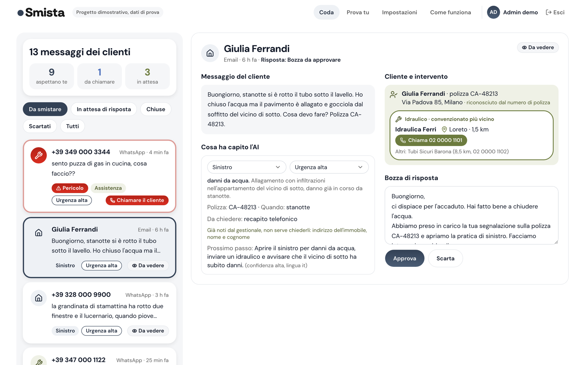
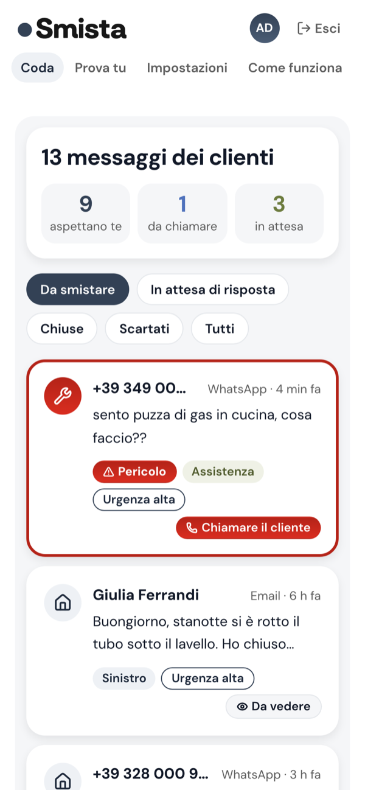

<div align="center">

# Smista

**L'AI legge, il codice controlla, l'operatore decide.**

Smistamento dei messaggi dei clienti per l'assistenza di un'assicurazione casa.

[](https://smista.vercel.app)


> **Progetto dimostrativo, dati di prova.** La compagnia, Assicurazioni Esempio, è inventata, come clienti, polizze e numeri di telefono. Nessun messaggio viene inviato davvero.

[**Prova la demo →**](https://smista.vercel.app) &nbsp;·&nbsp; si entra con l'account "Admin demo", senza password

<br>



</div>

## Il problema

Chi lavora nell'assistenza di un'assicurazione riceve messaggi molto diversi tra loro: un preventivo, un cambio di indirizzo, un reclamo con una scadenza di legge, una casa che si allaga, un odore di gas. Arrivano tutti nella stessa casella, in ordine di arrivo. Le urgenze vere rischiano di restare sotto le richieste semplici, e il tempo se ne va a rispondere sempre alle stesse domande.

**Smista mette in cima quello che non può aspettare, prepara le risposte e lascia partire da sole solo quelle a basso rischio.**

## Come scorre un messaggio



L'AI interpreta il testo. Le decisioni che contano (ordine della coda, scadenze, cosa può partire da solo) le prende il codice, con regole scritte e testate. L'ultima parola è dell'operatore.

## Cosa fa

| | |
|---|---|
| **Coda ordinata** | Prima il pericolo per le persone, poi le urgenze alte, poi i reclami per scadenza (con il conto alla rovescia dei 45 giorni), poi il resto. |
| **Analisi con l'AI** | Categoria, urgenza, dati estratti, dati mancanti, prossimo passo e bozza nella lingua del cliente. |
| **Regole che l'AI non può scavalcare** | Con un pericolo si usa un testo fisso scritto da una persona; un messaggio con istruzioni sospette va sempre a una persona; una bozza che promette coperture o rimborsi non parte mai da sola; un'urgenza alta non parte mai in automatico. |
| **Livelli per categoria** | Automatico, bozza da approvare o solo persona, regolabili dalla pagina Impostazioni. |
| **Tecnico più vicino** | Riconosce il cliente in un gestionale finto e propone il convenzionato più vicino, con il pulsante per chiamarlo. |
| **Prova tu** | Si scrive un messaggio e lo si vede analizzato dal vivo, con un limite giornaliero per IP. I messaggi non vengono salvati. |

<table>
  <tr>
    <td width="72%"></td>
    <td width="28%"></td>
  </tr>
  <tr>
    <td align="center"><sub>Un sinistro: cliente riconosciuto dalla polizza, idraulico più vicino, bozza da approvare</sub></td>
    <td align="center"><sub>Su telefono</sub></td>
  </tr>
</table>

## Come l'ho sviluppata

Requisiti, regole, casi di prova e criteri di accettazione li ho scritti io. Il codice è scritto con [Claude Code](https://claude.com/claude-code), un passo alla volta:

1. **Prima i test delle regole**, poi l'interfaccia.
2. **Ogni passo verificato** con type check, test unitari (Vitest) e prove nel browser (Playwright, su computer e telefono) prima di andare avanti.
3. **L'AI misurata**: 13 messaggi di esempio analizzati 3 volte ciascuno e confrontati con i valori attesi (`npm run valuta`). Il risultato è nella pagina "Come funziona".

Autore: Marco Parolin.

## Sicurezza e privacy

- Il testo del cliente viene passato all'AI come dato, tra tag dedicati, mai come istruzioni: un messaggio che prova a dare ordini all'AI viene segnalato e va a una persona.
- In pagina il testo si mostra solo come testo, mai come HTML.
- Le chiamate all'AI sono solo lato server; l'API accetta richieste solo dalla pagina della demo.
- Dei messaggi di "Prova tu" non si salva nulla: solo i contatori dei limiti, con l'IP trasformato in un hash.
- Funzioni e database in Europa (Francoforte). L'API di Claude non ha una region europea, e la pagina "Come funziona" lo dice.

## Stack

| Parte | Strumenti |
|---|---|
| App | Next.js 16 (App Router, Cache Components), React 19, TypeScript |
| Interfaccia | Tailwind CSS 4, shadcn/ui (Radix), icone Lucide |
| AI | API di Claude (`@anthropic-ai/sdk`), output strutturato validato con Zod |
| Dati | Postgres serverless (Neon), solo per i contatori dei limiti |
| Test | Vitest, Playwright |
| Deploy | Vercel, region `fra1` |

## Avviarla in locale

Serve Node.js 22 o più recente.

```bash
npm install
cp .env.example .env.local   # poi metti la tua ANTHROPIC_API_KEY
npm run dev                  # http://localhost:3000
```

Senza chiave l'app funziona lo stesso: la coda usa analisi già salvate e solo "Prova tu" risponde che l'analisi dal vivo non è disponibile.

| Comando | Cosa fa |
|---|---|
| `npm test` | test unitari (Vitest) |
| `npm run typecheck` | `next typegen` + `tsc` |
| `npm run e2e` | test nel browser (Playwright), su computer e telefono |
| `npm run build` | build di produzione |
| `npm run valuta` | misura l'AI sui 13 esempi (serve la chiave) |

Note di configurazione e problemi incontrati: [SETUP.md](SETUP.md).
